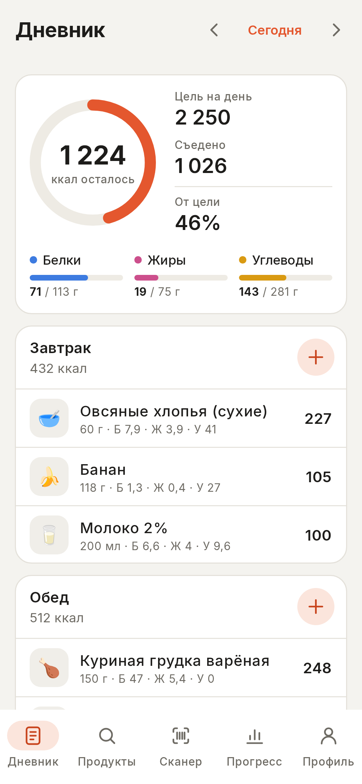
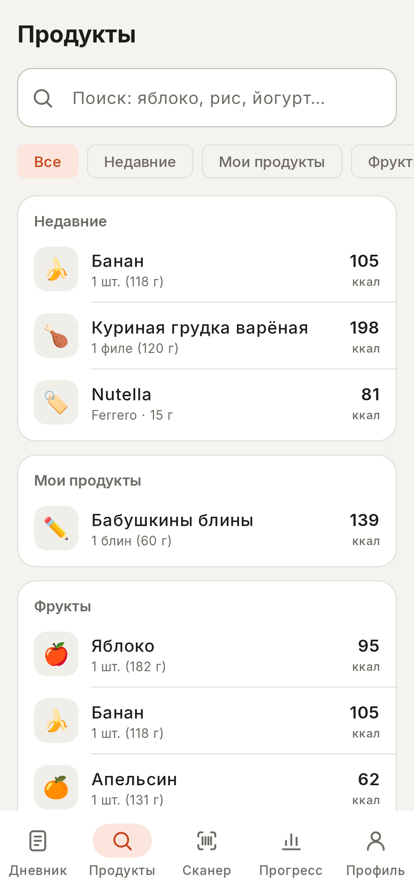
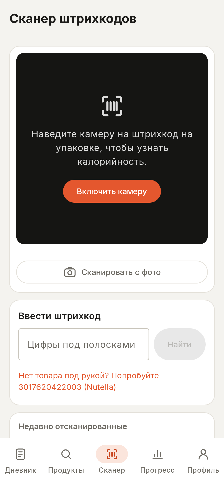
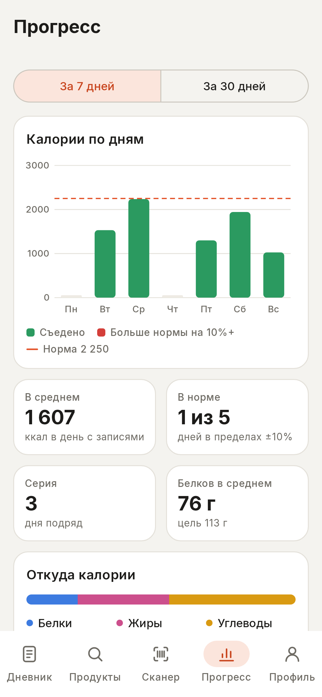
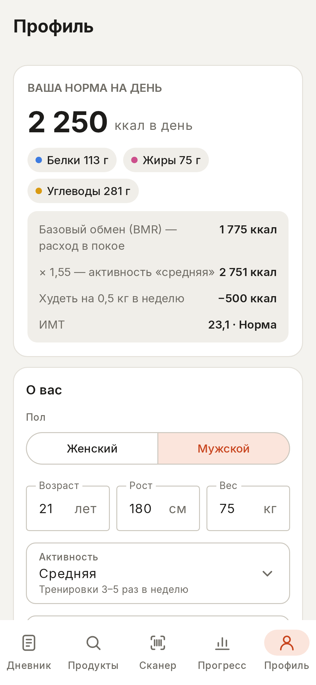
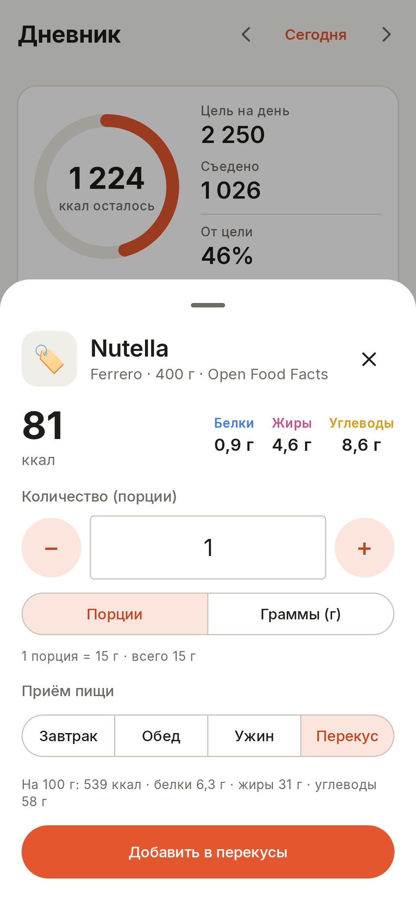

# MyBody: notes for the presentation

Everything below comes from the project's code and README. Screenshots are in
[`screenshots/`](screenshots/).

---

## 1. The problem it solves

- **People don't know how many calories they need.** Generic advice like
  "2,000 kcal a day" ignores a person's sex, age, height, weight and activity.
  The right number can differ by more than 1,000 kcal between two people.
- **Counting by hand is slow and error-prone.** You read the label, weigh the
  food, convert "per 100 g" to your portion and add everything up for every meal.
  Most people give up after a few days.
- **Packaged products are the most annoying part.** The values are printed on
  the box, but typing them in takes time. Scanning the barcode is much faster.
- **Many calorie trackers ask for an account** and keep your food diary on their
  servers, so they need internet to work.

**MyBody's answer:** calculate a personal daily target with a standard medical
formula, then make logging food take a few seconds: pick it from a list, search
online, or scan the barcode. Everything is saved on the phone.

---

## 2. Description

**One sentence:** MyBody is a native Android calorie counter that calculates
your personal daily calorie target and lets you log what you eat in seconds, by
searching a built-in food list, searching millions of packaged products online,
or scanning a barcode with the camera.

### The five screens

| Screen | What it does |
|---|---|
| **Дневник** (Diary) | Calories left today in a progress ring, protein / carbs / fat bars, and four meals (breakfast, lunch, dinner, snacks). Arrows to browse other days. |
| **Продукты** (Foods) | Search 149 common foods in 10 categories, your recent foods, your own foods, and the Open Food Facts product database online. |
| **Сканер** (Scanner) | Live barcode scanning with the camera, scanning from a photo, or typing the barcode number. |
| **Прогресс** (Progress) | Calories chart for the last 7 or 30 days, daily average, days on target, streak, and macro balance. |
| **Профиль** (Profile) | Calorie calculator, macro split, your own foods, and backup export / import. |

### Other features

- Amounts in grams / ml or in servings ("1 шт.", "1 ломтик").
- Create your own foods, with values per 100 g or per serving (converted automatically).
- Unknown barcode? Add the product yourself and it is found instantly next time.
- Scanned products are saved on the phone, so they also work offline.
- Undo after removing a diary entry.
- Light and dark theme follow the phone's setting.
- Fully Russian interface: Russian food names, number style (`1 234`, `0,4`),
  dates («Вс, 1 нояб.») and correct word forms («1 день», «3 дня», «5 дней»).

### How the daily target is calculated

1. **BMR** (calories burned at rest), Mifflin-St Jeor equation:
   men `10 × weight + 6.25 × height − 5 × age + 5`, women `… − 161`.
2. **TDEE** = BMR × activity factor (1.2 sedentary … 1.9 extra active).
3. **Goal:** 1 kg of body fat ≈ 7,700 kcal, so −500 kcal/day ≈ −0.5 kg per week.
   The target never goes below a safe minimum (1,200 kcal women / 1,500 kcal men).
4. **Macros:** the target is split by percentage (e.g. 20% protein, 50% carbs,
   30% fat); 1 g protein or carbs = 4 kcal, 1 g fat = 9 kcal.

*Example:* man, 21, 180 cm, 75 kg, moderately active, losing 0.5 kg/week →
BMR 1,775 → TDEE 2,751 → **target 2,250 kcal**.

### How a barcode is looked up

Camera (CameraX) → barcode read on the phone (ML Kit, works offline; a code must
be read in two frames in a row) → search order: **your own foods → products you
scanned before → Open Food Facts online**. If the product isn't found anywhere,
the app offers to add it.

### Project in numbers

| | |
|---|---|
| Screens | 5 main screens + bottom sheets (add food, new product, lookup) |
| Built-in foods | 149 in 10 categories |
| Barcode formats | EAN-13, EAN-8, UPC-A, UPC-E |
| Code | ≈ 5,500 lines of Kotlin |
| Unit tests | 38 (formulas, search, portions, forms, parser, backups, statistics, formatting) |
| Runs on | Android 8.0 and newer |

---

## 3. Screenshots

Rendered from the app's own UI code with sample data (a man, 21, 180 cm, 75 kg,
losing weight). Phone-screen size 1024 × 2216 px; the two "full" images show
the whole scrolling screen (1024 × 3938 px).

| File | What it shows |
|---|---|
| `01-diary.png` | **Diary:** calories left (ring), daily target, protein / fat / carbs bars, breakfast and lunch |
| `02-diary-dark.png` | The same Diary screen in dark theme |
| `03-foods.png` | **Foods:** search box, filters, recent foods, your own foods, categories |
| `04-foods-search.png` | Searching "рис" + button to search Open Food Facts online + "create your own product" |
| `05-scan.png` | **Scanner:** turn on camera, scan from a photo, type the barcode |
| `06-progress.png` | **Progress:** 7-day calories chart vs. the target line, average, days on target, streak |
| `07-profile.png` | **Profile:** daily target with the BMR → activity → goal steps, and the "About you" form |
| `08-add-food.png` | Adding a scanned product (Nutella) to the diary: portions or grams, meal choice |
| `09-new-product.png` | Unknown barcode → form to add the product yourself |
| `10-progress-dark.png` | Progress in dark theme |
| `11-progress-full.png` | Progress, whole screen (includes macro balance and daily log) |
| `12-profile-full.png` | Profile, whole screen (includes goal, macro split, my foods, backup) |








**Suggested for slides:** 01 (main screen), 05 (scanner), 08 (adding a product),
06 (progress), 07 (calculation), 02 (dark theme).

---

## 4. Similar applications

| App | Where it has an advantage over us | Where we have an advantage over it |
|---|---|---|
| **MyFitnessPal** | One of the largest food databases, including restaurant dishes; syncs between phone and web; connects to fitness trackers and Health Connect; exercise, water and weight logging; recipes and a large community. | No account needed; works offline; the diary never leaves the phone; simpler, faster interface; Russian food names and formatting. |
| **FatSecret** | Large database (millions of foods); diet calendar, weight log and exercise diary; recipes and a community; recognizes food from photos; available on iPhone and the web. | Modern Material 3 design with dark theme; no registration; offline; shows how the target is calculated, step by step. |
| **YAZIO** | Very polished design; fasting timer, recipes and meal plans; iPhone version and cloud sync. | Privacy (all data on the phone); open product data; add an unknown product in seconds and it's found next time. |
| **Cronometer** | Very detailed nutrition: dozens of vitamins and minerals; lab-verified food data; connects to many health devices. | Much easier for beginners; logging in servings ("1 шт.") instead of only grams; Russian interface. |
| **Open Food Facts app** | Same open product database plus Nutri-Score and NOVA ratings; lets users contribute products; open-source, large community. | It only shows product information. MyBody adds a personal calorie target, a daily food diary and progress statistics on top of that data. |

### Our advantages, summed up

1. **Privacy:** no account, no sign-up. All data stays on the phone; only barcode
   and search requests go to Open Food Facts.
2. **Works offline:** built-in food list, saved scanned products and an on-device
   barcode reader.
3. **Transparent maths:** the Profile screen shows each step (BMR → TDEE → goal)
   and explains it, with a safe minimum.
4. **Made for Russian speakers:** interface, food names, numbers, dates and word forms.
5. **Simple and fast:** five tabs, servings, recent foods, undo.
6. **Your data is yours:** export a backup file and import it on another phone.

### Where competitors are stronger (and our plans)

- Bigger, verified food databases, including restaurant dishes.
- Accounts and sync between devices; iPhone and web versions.
- Exercise, water and weight tracking, fitness tracker integration.
- Photo recognition of meals, recipes, meal plans, communities.
- Years of development by large teams.

**Ideas for next versions** (from the README): water and exercise tracking,
weight log with a chart, favourite meals, micronutrients (fiber, sugar, salt),
accounts and cloud sync (e.g. Firebase), a home-screen widget.

---

## 5. Technology stack

| Area | Technology |
|---|---|
| Language | **Kotlin** 2.3.20 |
| User interface | **Jetpack Compose** + **Material 3** (Compose BOM 2026.03.01) |
| Architecture | **MVVM**: Compose screens → ViewModel (StateFlow) → Repository → data sources; Kotlin Coroutines and Flow |
| App state | AndroidX Lifecycle / ViewModel 2.10.0 |
| Database on the phone | **Room** 2.8.4 (SQLite), code generated with KSP |
| Camera | **CameraX** 1.5.3 |
| Barcode reading | **Google ML Kit** Barcode Scanning 17.3.0 (model bundled, works offline) |
| Product photos | Coil 3.4.0 + OkHttp |
| Online product data | **Open Food Facts** REST API (JSON) |
| Built-in food values | Based on **USDA FoodData Central** |
| Font | Inter 4.1 (supports Cyrillic) |
| Build | Gradle 9.1 + Android Gradle Plugin 9.0.1, version catalog |
| Tests | JUnit 4, kotlinx-coroutines-test (38 unit tests) |
| Tools | Android Studio |
| Android versions | minSdk 26 (Android 8.0), target / compile SDK 36 |

Architecture in one line:

```
Compose screens → CaloScanViewModel → FoodRepository → Room database (phone)
                                                      → Built-in foods (in code)
                                                      → Open Food Facts (internet)
```

---

## 6. GitHub repository

**https://github.com/ZloyJirafik/project**

- Ready-to-install APK: `apk/MyBody-1.0.apk` in the repository, and on the
  [Releases page](https://github.com/ZloyJirafik/project/releases).
